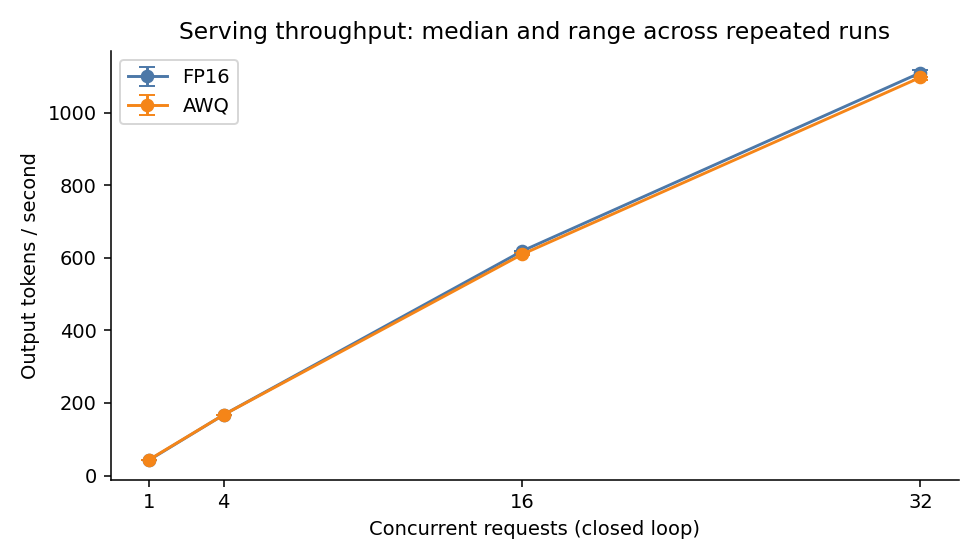
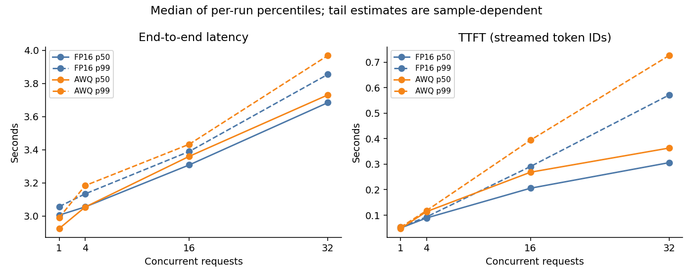
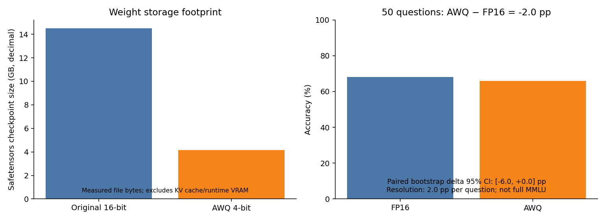

# Mistral inference optimization: FP16 → AWQ + vLLM

A reproducible benchmark of **Mistral-7B-Instruct-v0.3**, measuring the tradeoffs between
FP16 and activation-aware 4-bit weights, followed by deployment on an 8 GB laptop GPU.
The repository includes frozen workloads, per-request measurements, failure diagnostics,
quantization provenance, quality evaluation, and a Colab workflow.

**Measured finding:** AWQ reduced weight-file storage from **14.50 GB to 4.16 GB** and
ran on an **RTX 5060 Laptop GPU**. On an A100, AWQ serving throughput was within about
3% of FP16 across the tested concurrency levels. Quality changed from **68% to 66%**
on 50 frozen MMLU questions. This experiment demonstrates a capacity benefit; it does
not establish a substantial quantization speedup or quality equivalence.

## Results

All numbers below come from committed measured artifacts. Cloud experiments used the
same **NVIDIA A100-SXM4-40GB**. Both serving variants used vLLM continuous batching.
Each serving entry is the median across three runs of 512 requests; latencies are
medians of per-run percentiles. The final sweeps completed **6,144/6,144 requests per
variant with zero failures**.

| Concurrency | FP16 tok/s | AWQ tok/s | FP16 E2E p50 / p99 (s) | AWQ E2E p50 / p99 (s) |
|---:|---:|---:|---:|---:|
| 1 | 42.61 | 43.77 | 3.005 / 3.056 | 2.924 / 2.990 |
| 4 | 167.59 | 167.48 | 3.054 / 3.133 | 3.054 / 3.183 |
| 16 | 618.79 | 609.73 | 3.308 / 3.389 | 3.360 / 3.432 |
| 32 | 1,109.85 | 1,096.96 | 3.684 / 3.854 | 3.730 / 3.968 |

| Experiment | Measured result | Evidence |
|---|---|---|
| Transformers FP16, one request | 29.11 tok/s; 37.65 ms TTFT; 14.57 GB peak allocated VRAM | [Baseline](results/baseline_fp16.json) |
| AWQ W4A16_ASYM, group size 128 | 615.90 s quantization; 4.16 GB weight file | [Quantization](results/quantization.json) |
| Same 50 MMLU questions | FP16 34/50; AWQ 33/50; **−2 pp**, paired bootstrap 95% CI **[−6, 0] pp** | [Quality comparison](results/quality_delta.json) |
| RTX 5060 offline AWQ demo | 103 tokens in 1.59 s after warmup (64.93 tok/s); **7,579 MiB** sampled device VRAM peak | [Generation](results/edge_demo.json), [VRAM samples](results/edge_vram.csv) |

The baseline peak is PyTorch allocated memory, not device-wide usage. The laptop peak
includes desktop processes and vLLM's reserved KV cache, sampled every 200 ms; it can
miss short spikes. These are different memory measures, so no cross-engine VRAM
reduction percentage is claimed. The laptop measurement is one short offline inference,
not an HTTP serving comparison. Its answer interpreted “continuous batching” as
manufacturing: this is a functional smoke test, not evidence of answer correctness.
The 50-question paired test is the quality measurement; each variant produced one
invalid answer, counted as incorrect. One question changes accuracy by 2 pp.





See the [generated results report](results/REPORT.md), [summary CSV](results/summary.csv),
and [artifact definitions](results/README.md) for TTFT, raw requests, and comparability rules.
At concurrency 32, AWQ throughput was 1.16% lower than FP16. Increasing concurrency
improved aggregate throughput for both variants, while per-request latency increased.
The Transformers baseline uses a different engine and timing path; comparing it with
vLLM changes multiple factors and cannot isolate quantization or batching alone.

## Reproduce

Use Python **3.11** on Linux/WSL2. The measured stack is **PyTorch 2.9.1+cu128,
vLLM 0.15.1, llm-compressor 0.9.0, Transformers 4.57.3, compressed-tensors 0.13.0**.
Direct pins are in `pyproject.toml`; complete transitive pins are in
`requirements/gpu.lock.txt`. One environment supports quantization and inference;
AutoAWQ is not used. Record driver/package provenance and stop on compatibility errors
rather than silently swapping versions between variants.

Open the [Colab notebook](https://colab.research.google.com/github/rithwik0908/llm-inference-benchmark/blob/main/notebooks/colab_workflow.ipynb).
It pins an execution commit, preserves existing results, logs subprocess output, and
pauses between stages. Choose an A100 or L4 with **24 GB+ VRAM and 32 GB+ host RAM**;
A100/high RAM is preferred. Colab Pro does not guarantee a particular GPU. The preflight
accepts 22 GiB to accommodate nominal 24 GB cards; the free T4 is outside the controlled
FP16 configuration. L4 reproduction has not been measured.

```bash
python3.11 -m venv .venv-gpu
source .venv-gpu/bin/activate
pip install -r requirements/gpu.lock.txt
pip install --no-deps -e .
python scripts/preflight.py --min-vram-gib 22
python scripts/prepare_workload.py
python scripts/prepare_eval.py
python scripts/baseline_fp16.py
python scripts/quantize_awq.py
```

Run the baseline in isolation before quantization. Immediately evaluate the new AWQ
checkpoint, then FP16 on the same frozen set, before starting load tests. For each
variant, start the server in one terminal and the client in another:

```bash
bash scripts/serve.sh awq 2>&1 | tee results/server_awq.log
# Wait for: curl --fail http://127.0.0.1:8000/health
python scripts/evaluate_quality.py run --server-manifest results/server_awq.json
```

Stop AWQ and wait for GPU memory to release. Repeat those commands with `fp16`, then
run `python scripts/evaluate_quality.py compare` and review the quality delta.
For the serving phase, start **FP16 first**, run the following, stop it, and repeat
with AWQ:

```bash
python scripts/benchmark_serving.py --server-manifest results/server_fp16.json
```

The measured quantization took 10.3 minutes; the complete sweeps took about 105 minutes
for FP16 and 103 minutes for AWQ. Concurrency 1 dominates the budget. Runtime depends
on hardware and downloads. Preserve `models/mistral-7b-awq/` and `results/` outside
Colab before disconnecting. Existing sweep files are protected; archive old runs before
rerunning. Committed logs include an earlier invalid run and final successful runs.

## Methodology and integrity

- **FP16 baseline:** ten greedy, fixed-budget requests after two warmups, using the first
  frozen prompt (256 input / 128 output tokens). GPU-synchronized timing records the
  first generated token ID and total generation rate. Loading is excluded; no CPU/disk
  offloading is allowed. Token transfers to CPU are part of this instrumentation.
- **AWQ:** 4-bit weights, FP16 activations, asymmetric groups of 128. Calibration uses
  256 UltraChat training examples at 512 tokens. Model/data revisions, calibration-token
  hashes, recipe, weight bytes, and SHA-256 hashes are recorded. Checkpoint hashes are
  verified before serving and laptop inference. No evaluation questions enter calibration.
- **Serving:** both variants use eager vLLM, continuous batching, chunked prefill,
  FP16 KV cache, 2,048-token context, up to 32 sequences, and prefix caching disabled.
  Each concurrency (1, 4, 16, 32) runs three times on identical 512 frozen synthetic
  random-token prompts, with 256 input and exactly 128 output tokens. EOS stopping is
  disabled. Warmups are excluded. Closed-loop workers bound active requests; queueing
  before dispatch is excluded. This is not an arrival-rate/SLO test.
- **Accounting:** throughput is successful generated tokens divided by run wall time.
  TTFT is the arrival of the first generated token ID over HTTP; first-visible-text
  timing is separately nullable. Final usage, streamed ID count, finish reason, and
  `[DONE]` must agree. HTTP ID serialization overhead is included equally for both
  variants. Each variant had 24/6,144 completions without visible text; generated-token
  throughput includes special IDs and is not useful-text throughput.
- **Quality:** zero-shot, greedy, strict A–D parsing on the same frozen 50-question MMLU
  subset, selected reproducibly across subjects. Invalid answers count as wrong;
  transport errors abort. Delta is AWQ minus FP16 in percentage points. The paired
  bootstrap interval resamples questions; it does not establish quality equivalence.
- **Failure preservation:** an earlier text-only stream validator rejected two complete
  empty-text responses. Raw diagnostics exposed valid generated IDs. Both full sweeps
  were rerun under token-ID protocol 2; old invalid results were retained without
  backfilled timings. The plotter rejects invalid sweeps, different protocols, workloads,
  checkpoints, physical GPUs, serving settings, and relevant software versions.

## Laptop and Docker

Copy the **entire** AWQ checkpoint into `models/mistral-7b-awq/`, install the same GPU
lock, and run preflight. Record device memory in one terminal before starting inference:

```bash
nvidia-smi --id=0 --query-gpu=timestamp,name,uuid,memory.used \
  --format=csv,noheader,nounits --loop-ms=200 > results/edge_vram.csv
```

In another terminal:

```bash
python scripts/preflight.py --output results/preflight_edge.json
python scripts/edge_demo.py
```

Stop the recorder with Ctrl+C after inference. The actual laptop run used WSL2,
RTX 5060 capability 12.0, NVIDIA driver 592.82, and CUDA runtime 12.8. The engine used
Marlin compressed-tensor kernels, eager execution, one sequence, and a 1,024-token
context, with no CPU offloading. The first run included a long warmup; the reported
1.59 s covers the subsequent generation call only. Nonfatal WSL, optional-extension,
Requests, and NCCL shutdown warnings are retained in [the log](results/edge_demo.log).
**FP16 weights alone occupy 14.50 GB and cannot fit fully in the laptop's 8 GB VRAM.**
The 0.85 GPU utilization setting is a reservation budget, not a measured memory result.

After successful laptop verification, generate the report locally:

```bash
python scripts/plot_results.py
```

For serving via Docker (provided, **not executed in this experiment**):

```bash
docker build -f docker/Dockerfile -t mistral-benchmark:0.1 .
docker run --rm --gpus all --ipc=host -p 127.0.0.1:8000:8000 \
  -v "$PWD/results:/workspace/results" \
  -v "$HOME/.cache/huggingface:/root/.cache/huggingface" mistral-benchmark:0.1 fp16
# AWQ: also mount -v "$PWD/models:/workspace/models" and replace fp16 with awq.
```

Run both variants with the same image. Its version-tagged vLLM base owns the CUDA stack;
it is not byte-identical to the host lock. Record its image digest if benchmarking it.

## Validation and scope limits

```bash
python3 -m venv .venv-client
.venv-client/bin/pip install -r requirements/client.lock.txt
.venv-client/bin/pip install --no-deps -e .
.venv-client/bin/ruff check .
.venv-client/bin/ruff format --check .
.venv-client/bin/pytest -q
```

CPU tests cover protocol failures, concurrency limits, token accounting, quality math,
and report comparability. Synthetic test numbers live only in temporary directories.
GPU integration was measured on the A100 and RTX 5060; CI runs CPU checks.

**Deliberate cuts for the 1–3 day scope:** first-N calibration slice; 50-question quality
smoke test; synthetic prompts with one fixed token budget; eager mode; fixed concurrency
order; one cloud GPU; one laptop smoke prompt. Throughput error bars are repeated-run
min/max, not confidence intervals. Tail estimates from 512 requests have sampling
uncertainty. There is no full latency-distribution, energy, production SLO, or long-context
laptop study. Docker and L4 remain untested.

**With more time:** profile why AWQ was near parity, compare GPTQ, use real chat traces
and variable lengths, randomize sweep order, test CUDA graphs and speculative decoding,
expand concurrency, and run full MMLU plus held-out perplexity. Measure laptop startup
and memory under representative multi-turn workloads before claiming deployment readiness.

Implementation references: [pinned AWQ example](https://github.com/vllm-project/llm-compressor/blob/0.9.0/examples/awq/llama_example.py),
[vLLM quantization](https://docs.vllm.ai/en/v0.15.1/features/quantization/),
[Mistral model card](https://huggingface.co/mistralai/Mistral-7B-Instruct-v0.3),
[MMLU dataset](https://huggingface.co/datasets/cais/mmlu).
Respect upstream model/data licenses; model weights and credentials are excluded from Git.
